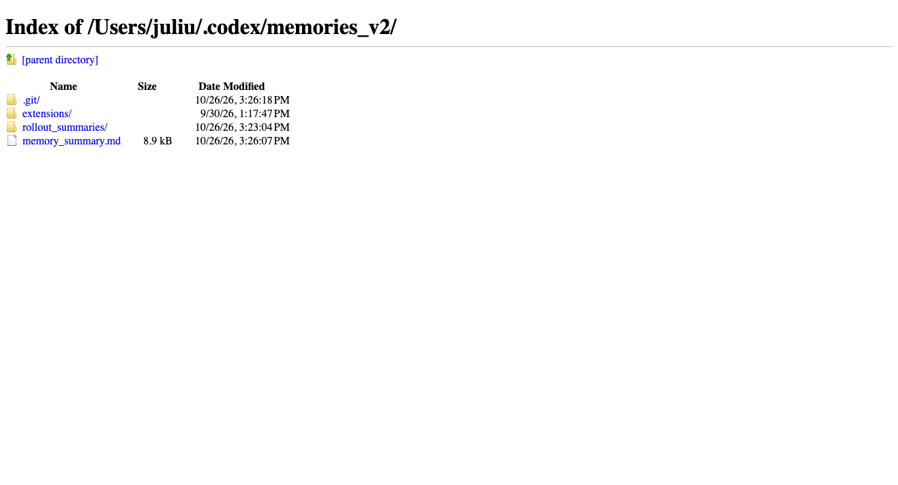
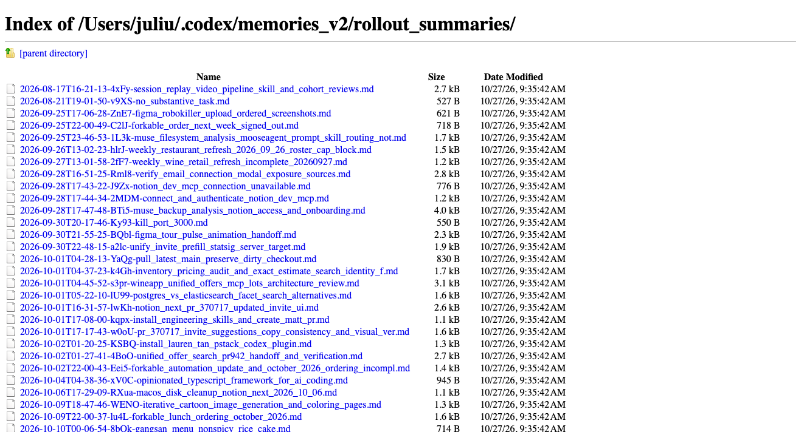
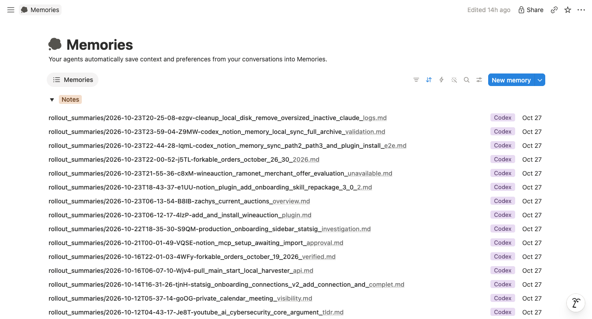

# Sync Memory verification

These screenshots were captured from the real local Codex memory directory and
the local Notion test workspace on October 27, 2026. They are browser screenshots,
not fixtures or generated mockups.

## Implementation

```text
Codex SessionStart
  → trusted hook starts a detached worker
  → worker starts a new codex app-server
  → Codex reuses the configured Notion connection's existing authorization
  → recursively copy memories_v2/**/*.md into Notion Memories
```

Stop also starts a bounded worker. The worker copies existing Markdown, then
checks for changes every five seconds within its watch window. Each relative
path maps to one Notion page. The plugin prepends source metadata and submits
the original Markdown without rewriting it. Git state, symbolic links and
non-Markdown files are excluded. The plugin does not handle OAuth tokens.

## Source directory

The root directory contains the summary, rollout summaries and extensions.
The visible .git directory is internal state and is excluded from copying.



Nested rollout Markdown files are included in the recursive scan.



## Local Notion Memories

The database list shows relative paths as titles and Codex attribution. This is
the disposable local test workspace used for the full-copy verification. Its
47 pages contain 46 existing source files and one explicitly synthetic note
added for incremental testing. The pages were initially populated with the
previous 0.4.2 package; the 0.4.3 relocation retains their mapping and sync logic.
Running the relocated 0.4.3 command returned 47 unchanged, zero created and zero
updated. A subsequent live verify detected a changed saved readback fingerprint
for the cleanup-local-disk rollout page. That check did not pass; no page or
mapping was overwritten to clear it.



## Verification boundary

The screenshot shows the rendered database list, not a byte-identical backup
guarantee or independent proof of all rows. The controlled incremental test
started a worker explicitly. Natural-conversation memory generation followed
by trusted native desktop hook dispatch has not been verified end to end.
Notion may normalize imported Markdown.
