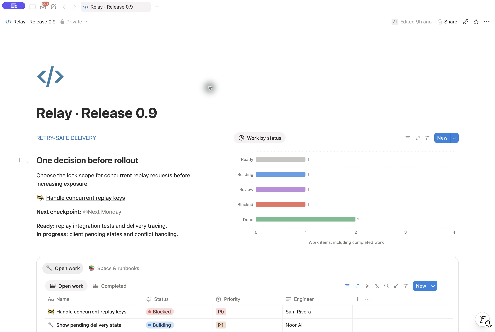
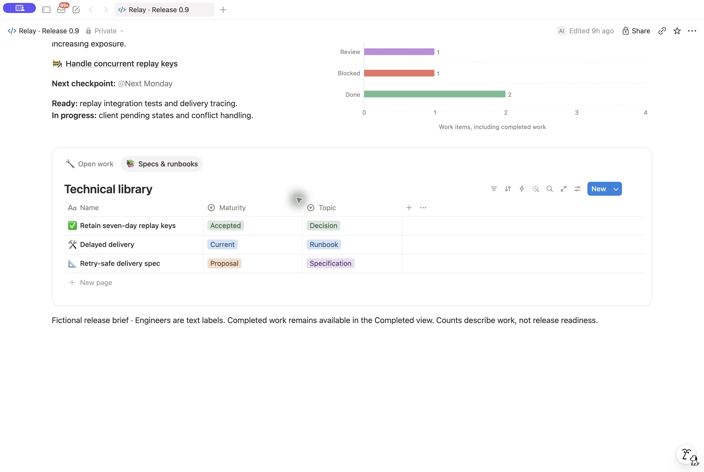

# Engineering design review — 2026-10-29

## Result and evidence

The existing [release test page](https://app.dev.notion.com/p/408b35e6e67f8128991de835b0b81f0a)
was refined into **Relay · Release 0.9**. These screenshots show the actual
Notion result with UI-assisted presentation settings. They are a design reference,
not a fresh independent skill pass. The earlier
[MCP-only test report](reference-workspace-results.md) remains unchanged and
describes the page before this refinement.

Screenshots refreshed on 2026-10-30 in the same Notion Dev window with one
app tab open and the sidebar closed. No page content or skill guidance changed
during this capture refresh.

## Changes and inspection

- Replaced the test-oriented page title with a short release title and a blue
  code icon.
- Paired the rollout decision and checkpoint with a compact horizontal status
  chart. Its labels show one each Ready, Building, Review and Blocked, and two
  Done. These are work counts, not a readiness score.
- Restored priority beside title, status and engineer. Full width makes all four
  fields readable together; the blocked P0 item stays first.
- Hid the repeated Release work heading above the Open work and Completed views.
- Inspected the technical library's three documents and their distinct Proposal,
  Accepted and Current states.
- Walked home → blocker → details → related spec → home. The spec has substantive
  behavior, unresolved decisions and rollout gates; its related work is preserved.
- Used the desktop app's Actual Size command and inspected with the sidebar visible
  during the original review. No new window was opened. Narrow-screen behavior was not tested.

## MCP capability gaps

| Setting                            | Intended result                                      | What was used                                                                                    |
| ---------------------------------- | ---------------------------------------------------- | ------------------------------------------------------------------------------------------------ |
| Standalone page width              | Full-width overview with readable work columns       | UI Appearance & layout → Full width; page update exposes no width setting                        |
| Existing database title visibility | Avoid repeating the destination name above its views | UI Layout → Show data source titles; view update exposes no title-visibility argument            |
| Explicit table column widths       | Deliberate widths if content clips                   | No width directive in the current view DSL; no resize was needed after full width in this review |
| Page font                          | Readable typography appropriate to technical content | Existing default retained; no font change was needed                                             |

MCP handled the title, colored icon, summary copy, chart configuration, property
visibility and cell wrapping. Existing record layouts, relations and technical
content were retained. Missing presentation controls do not remove requirements
from the skill. UI assistance is disclosed here, not passed off as MCP support.

## Test scope

This review verifies the refined release example and navigation, not repeatable
generation from clean context. The wiki-only branch was not rerun in this review.
The evaluation now requires priority to remain visible and distinguishes a
UI-assisted design reference from an independent reproduction. The prior
MCP-only smoke test is functional evidence, not evidence of the new visual bar.
