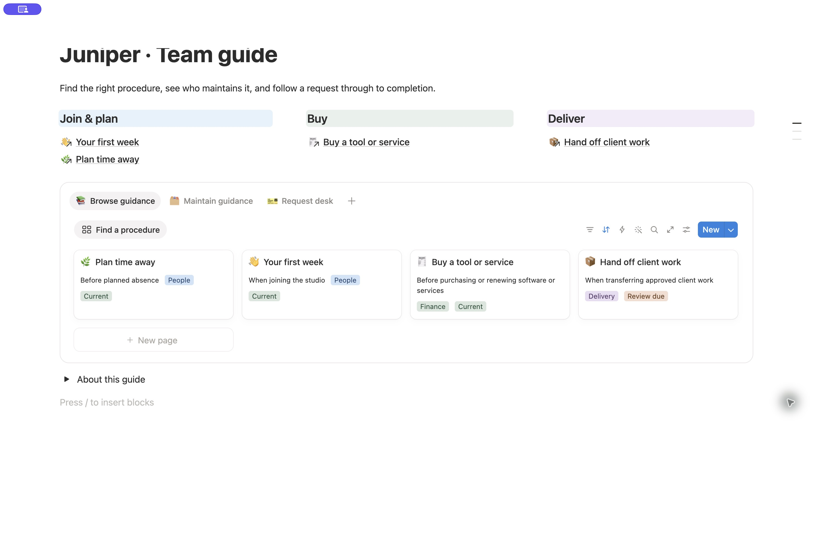

# Operations workflow evidence — 2026-10-29

**Design status: not yet accepted.** The checks below establish workflow and
readability for a constrained implementation, not the complete design benchmark.
The runtime now targets a browsable handbook, distinct maintenance table, and
request desk without encoding these MCP limitations as layout requirements.
No new skill execution or visual acceptance test accompanies this instruction
revision.

An isolated agent used the runtime skill and fictional team brief to create a new
private handbook and request desk. All workspace writes used Notion MCP.

Verified four complete procedures and four requests, reciprocal relations, and
saved-view counts of four guidance records, three open requests and one completed
request. The saved home places intent-based routes before native guidance/request
tabs containing real inline databases. Procedure bodies explain inputs, steps,
exceptions and completion; requests link to applicable guidance. No unsupported
policy threshold or real person assignment was invented.

Tool-contract errors were corrected before retrying: relation targets need bare
data-source UUIDs for this connection, and composition replacement uses new_str.
The test at that time required MCP-only writes and precise capability disclosure.

## Visual findings and instruction-led revisions

Initial inspection found long route descriptions, a library below the first
screen, and clipped essential fields. The skill was revised before each MCP
change. Compact intent headings, restrained background colors and direct links
replaced the tall directory; detailed procedure content remained on records.
The parent visually verified the compact colored home and native navigation from
request to related procedure and back home.

The evaluator's long test title was separately changed to `Juniper · Team guide`.
That was a harness correction, not evidence of skill improvement.

The library was then reduced to Procedure, Steward and Review so secondary Area
metadata would not displace review state. The request table clipped Due; a native
compact list was added with all four essential fields, preserving the original
table as an alternate. The parent subsequently verified both revisions at the inspected desktop width:
all four library titles, stewards and full review labels fit, and all three open
request titles, statuses, coordinators and full due dates fit clearly.

Actual saved-view readback confirmed:

```json
{
  "library": {
    "type": "table",
    "displayProperties": ["Procedure", "Steward", "Review"],
    "sorts": [{ "direction": "ascending", "property": "Area" }]
  },
  "compactRequests": {
    "type": "list",
    "displayProperties": ["Request", "Status", "Coordinator", "Due"],
    "filter": "Status != Done",
    "sort": "Due ascending",
    "queriedRows": 3,
    "has_more": false
  }
}
```

## Remaining limits

Earlier visual retesting was interrupted by screenshot/reconnect timeouts. After
UI recovery, the parent completed the library and compact-list checks above.
No narrow-viewport claim is made.

After the list passed, the reusable instruction was extended to promote a fitting
list without duplicating records. MCP created a linked list as the first work
surface inside Request desk, with a Completed list tab; the original database
remains a full-page alternate. Saved hierarchy confirms this placement, and view
queries confirm three open and one completed record. The parent then inspected the promoted block: all three open rows fit, and the
Completed tab showed Contractor access closed with its owner and October 28 date.
No UI settings mutation occurred.

Standalone home full-width, existing database title visibility and saved-default
selection were absent from the inspected MCP controls. No UI settings rescue
occurred. This single-brief smoke test does not establish visual parity or reliability
across briefs. The desktop workflow checks passed after the documented revisions.

## Capability backlog from the earlier test

Keep this implementation evidence outside the runtime design instructions. Verify
each control against current MCP schemas before treating it as a current gap.

| Intended control                   | Earlier evidence                   | Design impact to inspect                                                              |
| ---------------------------------- | ---------------------------------- | ------------------------------------------------------------------------------------- |
| Standalone home full width         | Absent from inspected MCP controls | Fit the guidance library and request metadata at intentional widths.                  |
| Existing database title visibility | Absent from inspected MCP controls | Remove duplicate headings without removing the working view.                          |
| Saved default view                 | Absent from inspected MCP controls | Open the correct employee or operator surface by default without adding another copy. |

These observations do not establish that galleries, colored sections, native
relations, or record layouts are unavailable. Those features require their own
checks. Capture the best finished design, including authorized UI adjustments,
and record that UI delta separately from any claim of MCP reproduction.

## Refined design reference — 2026-10-29



Refined the existing test workspace through MCP and inspected it in Notion.
Three colored routes orient the reader. Native tabs separate the procedure
gallery, maintenance table, and request desk. The gallery shows when to use each
procedure, its area, and review state; the maintenance table retains the steward.
This applies the library reference's data-first organization and the agency
reference's colored section hierarchy without turning the guide into a dashboard
of unrelated widgets. Existing procedures and requests were retained.

| Setting                                                      | Execution evidence                                                             |
| ------------------------------------------------------------ | ------------------------------------------------------------------------------ |
| Colored routes, native tabs, new gallery, maintenance fields | Created through MCP.                                                           |
| New linked gallery with hidden source title                  | Supported by create-view; applied through MCP.                                 |
| Standalone home full width                                   | Applied in UI; current page-update schema exposes no standalone width control. |
| Gallery text wrapping                                        | Applied in UI; current view DSL does not expose wrap-all for galleries.        |
| Request title, status, coordinator, and full due date        | Inspected in the existing request desk; no field removed to fit.               |

This PNG is the strongest inspected design from this refinement, including UI
settings. It does not establish independent skill reproduction or MCP-only
parity. The runtime retains the full design target. Narrow-screen behavior and
a fresh execution against this revised reference remain unverified.
