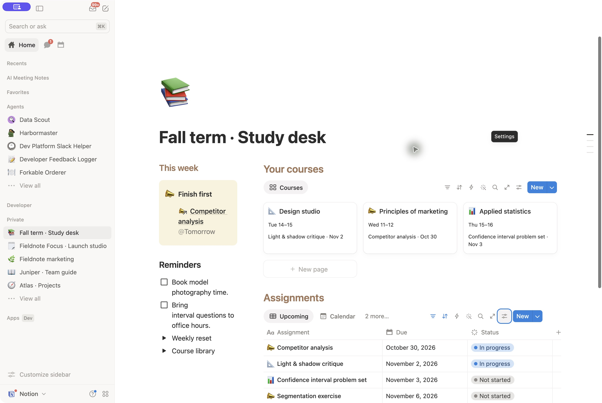

# School workflow smoke test — 2026-10-29

An independent agent received the runtime skill and fictional semester brief,
without baseline page IDs or grading criteria. It created a new private workspace
through Notion MCP. Existing semester pages were preserved. All content and layout
changes used MCP; UI was used only for inspection and navigation.

## Verified data and workflow

- Three course records and five assignments retain dates, states, weights, rooms
  and office hours. Course bodies contain useful explanations and suggested study
  questions; assignment bodies contain briefs and next steps.
- Reciprocal course relations and course-filtered views connect the records.
- Saved-view queries returned Upcoming 4, Calendar 5, Completed 1 and Undated 0.
  Upcoming is ordered October 30, November 2, November 3, November 6.
- Record full-width settings saved through the data-source layout capability.
- The rendered retest first screen shows the competitor-analysis priority,
  course navigation and all four Upcoming rows with due dates and status visible.
- The reviewer opened Marketing, inspected its study material and two related
  assignments, then opened Competitor analysis with pinned due/status and its
  substantive brief, and checked the home backlink.
- Completed showed the one submitted Wayfinding journal. The October Calendar
  showed dated entries; all five Calendar records were verified by MCP query,
  not all five visually inspected in the calendar.

## Revisions and acceptance

The first output included unnecessary design-research commentary. After preserving
that evidence, the runner applied revised reusable guidance through MCP to remove
it. Initial UI access was blocked by a hanging inspection call; subsequent native
inspection worked and identified excessive wrapping in the 25% reminder rail and
stacked course cards pushing assignment dates below the first screen.

The runner revised the reusable limited-width guidance before resuming the same
workspace through MCP. The resulting continuous layout puts a concise priority
and compact course navigation above the working assignment table, followed by
reminders and substantive course cards. All record and database IDs were retained.
The final rendered workflow passed the desktop checks above, but the simplified
continuous layout did not establish the target study-desk design. This is a resumed
test after instruction changes, not an untouched first-pass success. The harness
also removed its test label from the page title as a separate cleanup.

Screenshots retained with the local run evidence are `home-retest.png` and
`assignment-retest.png`. Narrow-viewport behavior and browser zoom were not
measured. Do not interpret this desktop pass as narrow-screen verification or
pixel parity with a template reference.

## Capability limits and scope

Standalone home width/font and no-cover gallery sizing/property wrapping were not
exposed by the inspected tools. The COVER directive supports file-property card
sizing; that alternative was not exercised. A complex course-record layout failed
with a generic validation error; a simpler full-width layout succeeded, with
related work in inline filtered views. The revised home works at the available
width without requiring unsupported layout settings.

The earlier UI-assisted sample does not establish MCP-only parity. This smoke
test also does not establish reliability across different semester briefs.

## Design acceptance correction

The earlier desktop pass established working data, navigation, and readable
deadlines. It did not establish the intended composition of a compact action
rail, useful course gallery, and inline upcoming assignments. Keep that target
in the runtime skill regardless of current MCP coverage. The continuous layout
was a temporary implementation compromise, not a replacement benchmark.

Use the best rendered workspace for design screenshots, including UI-assisted
settings when needed. Record each such setting, its visible effect, and the
missing MCP operation here rather than changing the design target. Keep this
benchmark evidence distinct from independent execution results. The visual refinement below followed this instruction revision; it is not a new
independent skill execution.

## Refined design reference — 2026-10-29

Refined the existing test workspace through MCP, then inspected and adjusted
its presentation in Notion. The protected original semester page was untouched.
The initial desktop screen now shows a narrow reminder rail, three course cards,
and actual upcoming deadlines. This applies the assignment-tracker reference's
asymmetric composition and useful course summaries. The existing records remain
connected. Course is still available on assignment records; adding it to the
compact home table and testing narrower screens remain acceptance follow-ups.

| Setting                                                                  | Execution evidence                                                                                     |
| ------------------------------------------------------------------------ | ------------------------------------------------------------------------------------------------------ |
| Columns, colored headings, priority, native gallery and assignment table | Created through MCP.                                                                                   |
| Standalone home full width                                               | Applied in UI; current page-update schema exposes no standalone width control.                         |
| Gallery small card size and wrapping                                     | Applied in UI; the current view DSL exposes card layout, not these two controls.                       |
| Hide existing assignment source title                                    | Applied in UI; update-view has no title visibility field. Creation of new linked views does expose it. |

The PNG records the strongest inspected version from this refinement, including
UI settings. It is a design reference, not proof of MCP-only reproduction or a
fresh unassisted skill pass. The runtime instructions retain the complete design
target. Capability findings belong in this evidence, not in reduced requirements.
