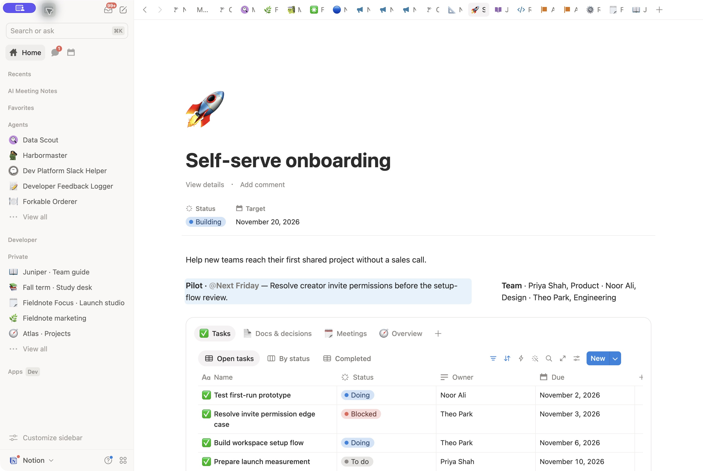
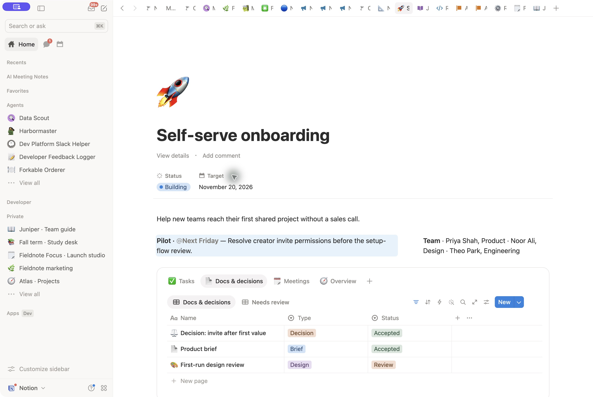
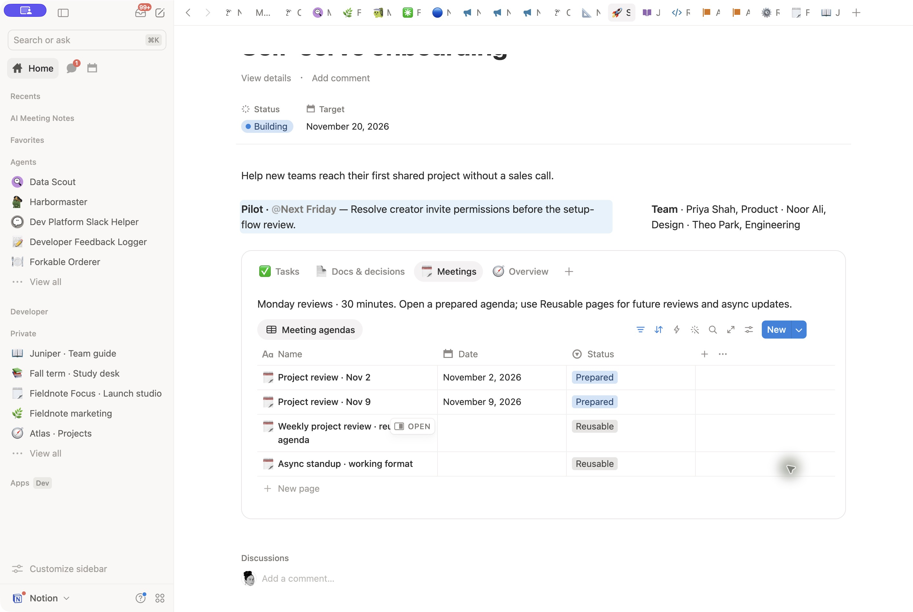

# Project workflow smoke test — 2026-10-29

**Scope:** this historical run establishes functional workflow coverage only. It
does not meet the full design bar: actual task rows were below the first screen,
and normal-zoom/sidebar and narrow-screen coverage were not established. Preserve
these observations as evidence while a separate polished design reference is built.
The runtime now describes that target independently of MCP capability gaps.

An isolated agent used the fictional project brief and revised runtime skill to
create a private portfolio with two Projects records and shared Tasks, Docs and
Meetings databases. All writes used Notion MCP. Existing unrelated pages were
preserved. The final result is a resumed test, not a first-pass success.

## Verified through MCP

- Seven tasks retain supplied states, dates and fictional owner names as text;
  the second project's task remains undated.
- Three substantive documents distinguish accepted decisions from proposals.
- Two dated weekly agendas plus reusable weekly-review and async-standup formats.
  These are ordinary records, not scheduled recurring templates or past minutes.
- Exact filters: main project five open, six total, one completed; second project
  one undated task. Three docs, one review item and four meeting/format records.
- Related project/doc links and native tabs containing inline work views.
- Native Status-only pinning succeeded, followed by Status-plus-Target pinning.
  Final layout pins Status and Target. The properties module is in the sidebar
  with Lead, Outcome and Summary hidden; lead and outcome remain in the body.
- Portfolio cards show short faithful summaries instead of the clipped full
  outcome. The source outcome is preserved. Parent title is Atlas · Projects.

## Visual inspection and iteration

The initial native-app call stalled and was aborted after 804.3 seconds without
returning state. The parent evaluator later obtained a working UI and visually
inspected the initial portfolio and project first screen. Milestone/team layout
was useful, but duplicate outcome and tall vertical properties pushed the working
tabs down, and the portfolio outcome text clipped.

The runner revised reusable guidance before applying corrections through MCP to
the same records: keep the full outcome once near the top, use a short card
summary when needed, and test a smaller supported pinning subset before declaring
all pinning unsupported. The initial mixed Status/Lead/Target pinning request had
failed; its validation error did not identify the cause. The successful Status
and Target trials supersede the earlier blanket pinning limitation. Lead remained visible in the intermediate layout; the final layout below moves
secondary properties out of the main reading flow.

A later screenshot/reconnection timeout temporarily interrupted the retest. UI
subsequently recovered and the final desktop workflow was inspected as recorded
below. MCP reads alone were not treated as visual evidence.

## Harness and evidence

Initial output and raw read/query results were preserved before retries. Raw
pinning requests/results and the original validation error were saved locally.
The private parent naming cleanup and corresponding brief destination change
remove test labels from the product; these are harness corrections, separate
from reusable skill behavior. No UI mutations were used by the runner.

## Subsequent rendered check and compact-layout correction

The parent recovered UI and verified portfolio cards with full titles, short
summaries, status and dates. Status/Target pins rendered successfully on the full
project page, but the remaining Lead properties section consumed excessive space
and left work tabs below the fold. Guidance was revised again before MCP writes.

Omitting the properties module entirely failed with INVALID_ARGUMENT. Moving it
to the documented sidebar and hiding Lead/Outcome/Summary succeeded. This keeps
Status/Target native pins and the explicit project lead in Team while removing
the main properties section. The original mixed-pin failure cannot be attributed
to the Lead type: that original request also omitted a properties module.
Raw errors and successful requests are saved. The final rendered check below
covers this sidebar correction and task/doc/meeting navigation.

## Final desktop workflow pass

The parent evaluator completed the final desktop walk. Portfolio cards show two
projects with full titles, status, dates and short summaries that fit. The project
first screen shows pinned Status/Target, a single outcome, pilot/risk and team;
the properties module is out of the main reading flow. Task tabs and the table
header reach the bottom edge of the first screen; actual task rows require
scrolling. This is not a claim that tasks are visible above the fold.

After scrolling, all five open tasks display full Name, Status, Owner and Due
columns without clipping. The evaluator opened the blocked task, followed its
body link to the accepted decision and inspected substantive detail. On returning,
Meetings displayed all four prepared/reusable records; the Nov 2 agenda contained
a useful timed agenda, pre-read and task links. This is a desktop workflow pass
for the resumed output. No zoom-change or narrow-screen pass was performed.
Parent screenshots are saved as portfolio-retest and home-retest in temporary
evidence. No further page changes were made after this verification.

## Capability evidence for the design reference

| Intended result                                              | Evidence from this run                                                                                                                              | Remaining verification                                                                                                       |
| ------------------------------------------------------------ | --------------------------------------------------------------------------------------------------------------------------------------------------- | ---------------------------------------------------------------------------------------------------------------------------- |
| Native status, lead, and target metadata in a compact header | Status and Target pins succeeded. The initial mixed request also omitted a required properties module, so it does not establish a Lead-pinning gap. | Test Lead pinning with a valid layout before classifying it as unsupported.                                                  |
| Secondary metadata outside the reading flow                  | The sidebar properties module saved and rendered.                                                                                                   | Supported; this is not an MCP gap.                                                                                           |
| Readable portfolio cards with useful project context         | Short summaries fit; the full source outcome was preserved.                                                                                         | Inspect card size and wrap controls separately; do not assume shorter text proves a control is unavailable.                  |
| First actionable task alongside project context              | Task tabs reached the first-screen edge; task rows required scrolling.                                                                              | Design miss. Refine the composition and record any specific UI-only adjustment; do not attribute it to MCP without evidence. |
| Weekly/standup workflow                                      | Agendas and reusable format records were created.                                                                                                   | Native reusable/recurring template support was not established. Ordinary agenda records do not prove scheduled recurrence.   |

No new execution or visual verification is claimed by this documentation update.
Capture the best design reference separately, identify the tools used for each
adjustment, and test skill reproduction against that fixed quality target.

## Refined design reference — 2026-10-29

Shortened the milestone and team blocks through MCP while preserving their
meaning. Inspected the project in Notion with the sidebar visible: native status
and target, outcome, milestone, team, and actionable task rows now appear on the
initial desktop screen. This addresses the earlier above-the-fold failure as a
composition problem; no new UI presentation setting was needed for this change.
The layout follows the project-hub principle of concise context above connected
work, with restrained color and purposeful icons.

Switched among Tasks, Docs & decisions, and Meetings. The docs view shows three
records with their type and review state. Meetings shows two prepared dated
agendas and two clearly labeled reusable pages. These existing pages are not
native database templates and do not establish scheduled recurrence. Creating
and verifying a native reusable meeting template remains an acceptance follow-up;
the runtime continues to require it.

| Setting                                                                  | Execution evidence                                                              |
| ------------------------------------------------------------------------ | ------------------------------------------------------------------------------- |
| Compact milestone and team composition                                   | Updated through MCP; task rows visibly fit with the sidebar open.               |
| Project-record width, status and target pins, secondary property sidebar | Previously configured through MCP and visibly retained.                         |
| Lead pinning                                                             | Not retested with a valid layout request; no unsupported-capability conclusion. |
| Native meeting template and recurrence                                   | Not established by ordinary reusable agenda records; remains unverified.        |

These PNGs document the refined design reference. They are not a fresh independent
skill run. Prior record/filter checks remain separately recorded above. This
revision retains the full design target, removes MCP-specific compromises from
runtime guidance, and keeps capability findings in evaluation evidence. No
narrow-screen pass is claimed.
